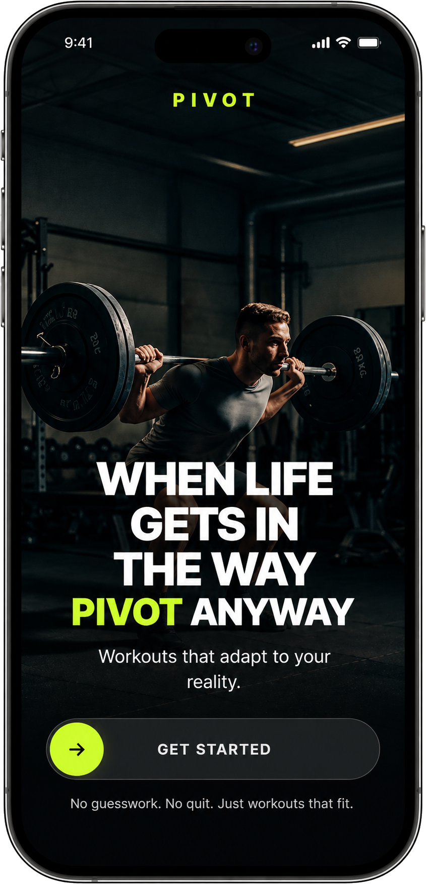

# Pivot

  

Most fitness apps optimize for plan consistency. Pivot optimizes for training consistency.

Recovery fluctuates. Equipment is unpredictable. Energy changes. Time runs short. Pivot adapts workouts to real-world constraints so users can keep training when their original plan no longer fits.

## The Problem

Traditional workout plans assume predictable schedules, recovery, and equipment availability.

But real life gets in the way. You slept five hours instead of eight, the gym is crowded, your available time drops to 20 minutes, or an exercise becomes uncomfortable.

A rigid plan leaves users to figure out what to change and how to preserve the intent of their session.

**Pivot treats changing conditions as inputs to the workout, not reasons to abandon it.**

## How It Works

### 1. Daily Check-In

Users provide a quick snapshot of their current condition:

- Sleep and energy
- Soreness or pain
- Available training time, from 10 to 120 minutes
- Additional constraints, when needed

### 2. Adaptive Workout Generation

Pivot generates a workout based on readiness, training focus, available time, and constraints. The system validates key requirements server-side and provides reasoning for the generated workout.

### 3. Live Pivoting

When equipment is unavailable or a constraint changes mid-session, users can request a replacement exercise.

Pivot aims to preserve the intended training stimulus while respecting the new constraint. Each pivot records the replacement and its rationale, creating a persistent history of how the workout evolved.

## What Makes Pivot Different

- **Constraint-aware generation:** Composes workouts around current conditions rather than relying solely on fixed templates.
- **Explainable adaptations:** Shows users why an exercise or workout was selected.
- **Persistent pivot history:** Preserves actual substitutions and their reasoning.
- **Recovery-aware re-entry:** Supports adapted workouts after four or more missed days.
- **Graceful degradation:** Uses deterministic fallback logic when AI output cannot be used.

## Architecture

**Design principle: AI composes. Deterministic logic enforces constraints.**

### AI Composition

**Google Gemini 2.5 Flash**

Generates exercise selections and contextual reasoning based on the user's current circumstances.

### Backend and Validation

**Supabase Edge Functions (Deno)**

Validate workout requirements, handle invalid AI output, and record pivot events.

Key responsibilities include:

- **Focus validation:** Checks alignment with the requested training focus.
- **Duration validation:** Checks the workout against the available time budget.
- **Fallback handling:** Routes invalid output through deterministic workout logic.
- **Pivot logging:** Records substitutions and their reasoning.

### Example: Constraint Validation

A user requests a 20-minute leg workout, but the model returns a 45-minute upper-body workout.

The system should reject the invalid result and route it through the appropriate fallback or regeneration path rather than presenting it as a valid workout.

This illustrates the intended architecture. Actual behavior depends on the implemented validation and fallback logic.

## Current Status

Pivot is a working prototype deployed in production.

The project includes adaptive workout generation, focus and duration validation, exercise substitutions, pivot history persistence, and recovery-aware re-entry.

Current development focuses on generation reliability and constraint handling. Implemented functionality is not the same as proven reliability or demonstrated improvements in training consistency.

## Roadmap

- **Progression tracking:** Remember movement-level performance across sessions.
- **Fatigue modeling:** Account for longer-term training load.
- **Adaptive microcycles:** Use weekly training patterns to inform individual sessions.
- **Richer personalization:** Combine readiness, performance history, equipment, and training goals.

## Tech Stack

- React 18
- TypeScript
- Vite
- Tailwind CSS
- shadcn/ui
- React Context
- localStorage
- Supabase Edge Functions (Deno)
- Google Gemini 2.5 Flash

## License

Private project. All rights reserved.
